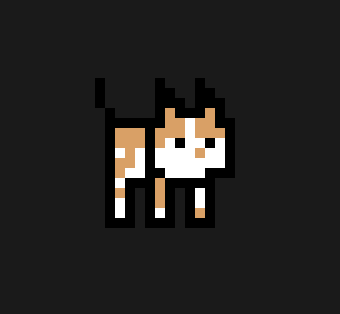

# CharliePet

## A pet that lives in your PC and steals your food

Anyway uh, README time!

## What does the pet do?
- It follows your mouse
- It sleeps if you leave it (why would you D:)
- You can pick it up and put it somewhere else
- If it is clicked, it will meow and stay in one place. Click him again and he is freed

## How to adopt a CharliePet
~~Walk into a pet shop and look for one~~
Download the exe from [here](https://charliecatmeow.itch.io/charliepet)

## Art is made by me
First time using Aseprite, it turned out okay tho.

### Have fun with it